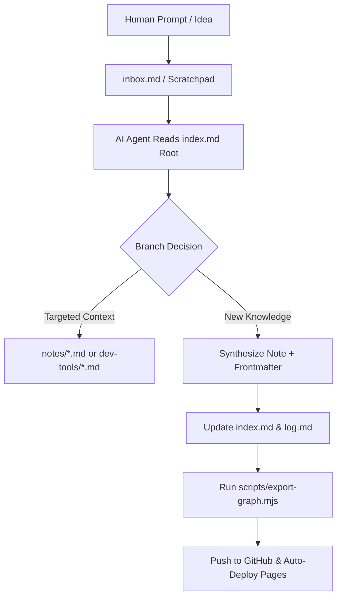

<div align="center">

# 🧠 Second Brain
### Agentic AI Context Architecture • Google OKF v0.2 • Interactive Mind Map

[](https://github.com/ericcgu/second-brain)
[](https://ericcgu.github.io/second-brain/)
[](https://github.com/ericcgu/second-brain)

*A low-friction, agent-native personal knowledge management engine designed for both human clarity and LLM context precision.*

[🌐 Live Docs](https://ericcgu.github.io/second-brain/) • [🕸 Graph](https://ericcgu.github.io/second-brain/graph/) • [🧭 Mind Map](https://ericcgu.github.io/second-brain/mindmap/) • [Architecture](#-architecture--progressive-disclosure) • [Agent Guidelines](#-agent-native-workflow-agentsmd) • [Getting Started](#-quick-start)

---

</div>

## 💡 Overview

Traditional "second brains" (Obsidian, Notion, Foam) often degenerate into sprawling spiderwebs of bidirectional links. While visually interesting, this structure suffers from two fatal flaws:
1. **Human Friction:** Maintaining tags, metadata, and folders creates cognitive drag, leading to abandoned systems.
2. **LLM Context Bloat:** Feeding unstructured link mazes into AI coding agents (Antigravity, Gemini, Claude, Cursor) triggers exponential token consumption, lost context, and hallucinations.

**This Second Brain solves both.** Built on **Google's Open Knowledge Format (OKF v0.2)**, knowledge is structured as a **hierarchical progressive-disclosure tree**. AI agents read only high-level indexes before selectively traversing specific nodes, preserving token budgets and maximizing retrieval precision. 

The exact same knowledge tree automatically compiles into an **interactive Mind Map and Developer Docs portal** with zero external dependencies.

---

## ⚡ Key Highlights

- **🤖 AI-First, Human-Effortless:** The AI agent handles 100% of formatting, tagging, indexing, changelogs, and mind-map regeneration. Humans only need to dump thoughts into [`inbox.md`](./inbox.md).
- **🌲 Progressive Context Disclosure:** OKF v0.2 hierarchical structure allows AI assistants to navigate vast knowledge bases without loading entire repositories into context.
- **🎨 Interactive Mind Map & Docs Portal:** Self-contained build pipeline (`scripts/export-graph.mjs`) generates a high-performance web dashboard featuring:
  - Dynamic canvas-based mind map with smooth Bezier curve connections.
  - Multi-panel dockable workspace (Mind Map, Docs, Split View).
  - `Cmd+K` Spotlight command palette with MiniSearch fuzzy matching.
  - Tokyo Night Storm syntax highlighting with instant code copying.
  - Triple-theme switcher (*Paper*, *Light*, *Dark*).
- **🔗 Shareable View URLs:** Every visualizer has its own link:

  | View | URL |
  |------|-----|
  | Docs + Mind Map (split) | [`/second-brain/`](https://ericcgu.github.io/second-brain/) |
  | Graph | [`/second-brain/graph/`](https://ericcgu.github.io/second-brain/graph/) |
  | Mind Map | [`/second-brain/mindmap/`](https://ericcgu.github.io/second-brain/mindmap/) |

  Any view also accepts `?view=graph|mindmap|docs|split`, and a note hash such as `#notes%2Fopen-knowledge-format.md`.
- **🚀 Zero-Dependency Deployment:** Native Node.js build system with automated GitHub Actions CI/CD to publish directly to GitHub Pages.

---

## 🏗 Architecture & Progressive Disclosure

```
second-brain/
├── index.md                  # Root Table of Contents (okf_version: "0.2")
├── inbox.md                  # Human scratchpad & quick capture (type: inbox)
├── log.md                    # Automated AI changelog
├── AGENTS.md                 # System instructions & rules for AI assistants
├── notes/                    # Knowledge base (type: note, concept, reference)
│   ├── open-knowledge-format.md
│   └── how-to-use-this.md
├── dev-tools/                # Replicable system environments & AI prompts
│   ├── index.md
│   ├── macos-terminal-tokyo-glass.md
│   ├── tokyo-night-storm.md
│   └── agy-cli-permissions.md
├── scripts/
│   ├── validate-okf.mjs      # Fast YAML frontmatter & graph integrity validator
│   └── export-graph.mjs      # Standalone Mind Map & Docs HTML generator
├── site/
│   ├── index.html            # Compiled docs + mind map (split view)
│   ├── graph/index.html      # Graph view  →  /graph/
│   └── mindmap/index.html    # Mind map view  →  /mindmap/
└── .github/workflows/
    └── deploy.yml            # Automated GitHub Pages deployment pipeline
```

### Progressive Disclosure Flow



---

## 🤖 Agent-Native Workflow (`AGENTS.md`)

This repository is governed by an automated rule engine located in [`AGENTS.md`](./AGENTS.md). Whenever an AI assistant creates or updates content, it runs the maintenance checklist:

1. **Strict OKF Frontmatter:** Validates `type`, `title`, `description`, `tags`, and `updated` timestamps.
2. **Root TOC Synchronization:** Maintains bidirectional references in [`index.md`](./index.md).
3. **Audit Log:** Records single-line chronological entries in [`log.md`](./log.md).
4. **Validation & Build:** Executes:
   ```bash
   node scripts/validate-okf.mjs && node scripts/export-graph.mjs
   ```

---

## 🚀 Quick Start

### 1. Clone & Inspect
```bash
git clone https://github.com/ericcgu/second-brain.git
cd second-brain
```

### 2. Add or Edit Notes
Create a note under `notes/` with standard OKF frontmatter:
```yaml
---
type: concept
title: "Distributed Systems Consensus"
subtitle: "Raft vs Paxos comparison"
description: "Core trade-offs between leader-based consensus protocols."
tags: [architecture, distributed-systems]
updated: 2026-11-08
---

# Distributed Systems Consensus
...
```

### 3. Build & Preview Locally
Run the zero-dependency generator (no `npm install` required):
```bash
node scripts/validate-okf.mjs
node scripts/export-graph.mjs
```
Open `site/index.html` in your browser to view your live Mind Map and documentation.

---

## 🌐 GitHub Pages Deployment

The repository includes a GitHub Actions workflow ([`.github/workflows/deploy.yml`](./.github/workflows/deploy.yml)) that automatically builds and deploys your mind map whenever you push to `main`.

To enable:
1. Open your repository on GitHub &rarr; **Settings** &rarr; **Pages**.
2. Under **Build and deployment** &rarr; **Source**, select **GitHub Actions**.
3. Push to `main`:
   ```bash
   git add .
   git commit -m "docs: update second brain"
   git push origin main
   ```

---

## 🛠 Tech Stack

- **Format:** Google Open Knowledge Format (OKF v0.2)
- **Engine:** Pure Node.js (`node:fs`, `node:path`)
- **Search:** MiniSearch Client-Side Fuzzy Search
- **Syntax Highlighter:** Highlight.js (Tokyo Night Theme)
- **Visualizer:** HTML5 Canvas Bezier Tree Renderer
- **Typography:** Vercel Geist Variable Sans & Mono
