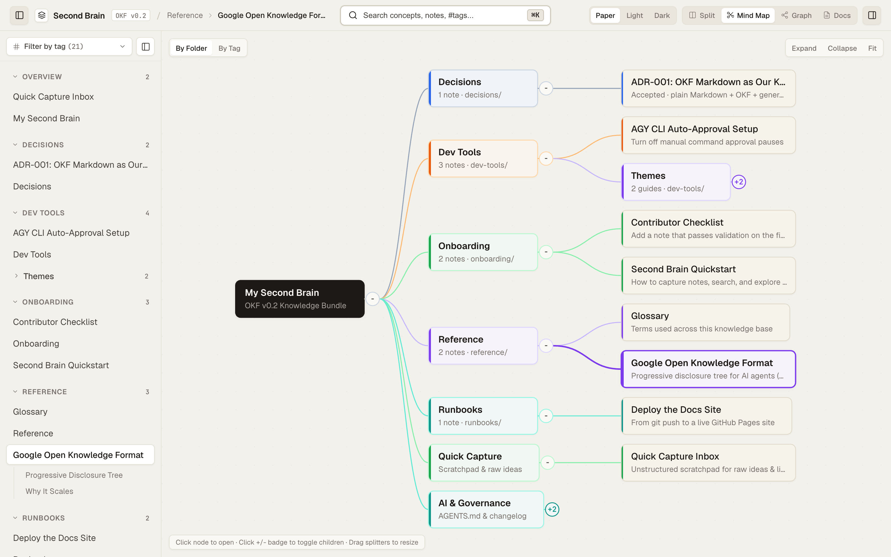

<div align="center">

# Second Brain
### The Human Agentic Orchestrator's Second Brain: Obsidian + Superior MkDocs for Fast-Moving AI Teams

**Turn scattered tribal knowledge, runbooks, and fast-moving AI setups into a single plain-Markdown Git repo with an interactive Mind Map, Force-Directed Graph, and Instant Full-Text Search — built on Google's Open Knowledge Format (OKF v0.2).**

[**Live Interactive Demo**](https://ericcgu.github.io/second-brain/) &nbsp;·&nbsp; [**Dead Simple to Use**](#dead-simple-to-use) &nbsp;·&nbsp; [**30-Second Quickstart**](#30-second-quickstart) &nbsp;·&nbsp; [**Interactive Mind Map**](https://ericcgu.github.io/second-brain/mindmap/) &nbsp;·&nbsp; [**AGENTS.md**](./AGENTS.md) &nbsp;·&nbsp; [**ARCHITECTURE.md**](./ARCHITECTURE.md)

[](https://github.com/ericcgu/second-brain/actions/workflows/deploy.yml)
[](./reference/open-knowledge-format.md)
[](./AGENTS.md)
[](./ARCHITECTURE.md)
[](https://ericcgu.github.io/second-brain/)

<br>

<a href="https://ericcgu.github.io/second-brain/"></a>

</div>

---

## Dead Simple to Use

There is nothing to learn, no database to configure, and zero setup friction:

- **Browse:** Open the site, click a branch in the Mind Map, or find any command or concept in the Instant Search bar.
- **Capture:** Jot rough thoughts and snippets in [`inbox.md`](./inbox.md) or tell your AI agent *"add a note about X"*.
- **Publish:** `git push` — one standard-library Node script builds and deploys your entire site.

---

## 30-Second Quickstart

Requires **Node.js 18+** (Node standard library only — **zero `npm install`**, sub-50ms execution):

```bash
# 1. Clone the repository (or click "Use this template" on GitHub)
git clone https://github.com/ericcgu/second-brain.git
cd second-brain

# 2. Validate OKF v0.2 frontmatter & links, then compile the static portal
node scripts/validate-okf.mjs
node scripts/export-graph.mjs

# 3. Open the interactive Split View (Docs + Mind Map + Graph + Instant Search)
open site/index.html
```

### Tell Your AI Agent to Do the Filing (Multi-Model Delegation)

Because [`AGENTS.md`](./AGENTS.md) is checked into the root of the repo, any AI coding agent automatically knows how to maintain this knowledge base and **which model tier to use for each task**:

- **Frontier Planning Model (`pro`):** Handles architecture decisions, synthesizes complex notes, and coordinates multi-step changes.
- **Fast, Low-Cost Execution Subagent (`flash-runner`, `Model: "flash"`):** [`AGENTS.md`](./AGENTS.md) dictates that deterministic tasks — formatting YAML frontmatter, updating `<topic>/index.md`, logging to [`log.md`](./log.md), running `node scripts/validate-okf.mjs`, and compiling `site/` via `node scripts/export-graph.mjs` — must be delegated to a fast subagent explicitly invoked with **`Model: "flash"`** for sub-second, low-cost execution.

Just say in chat:

```text
"Turn my rough notes in inbox.md into a clean runbook and rebuild the site."
"Add a note about our new staging deploy flags under runbooks/."
"Read index.md and summarize our terminal and CLI setup."
```

The primary agent plans the note and dispatches `flash-runner` (`Model: "flash"`) to write valid OKF frontmatter, update the topic `index.md`, link related concepts, log the change in [`log.md`](./log.md), validate every link, and regenerate `site/`.

---

## Why This Exists: Context Is King

> [!IMPORTANT]
> Forward-deployed engineering in 2026 has transformed developers into **Human Agentic Orchestrators** directing autonomous agent swarms. While AI writes code at superhuman velocity, engineering velocity is choked by the human comprehension gap and token-wasting context rot.

- **Human comprehension gap:** AI generates architectural artifacts faster than any developer can read walls of diffs or chat logs.
- **Context window rot:** Unstructured repos force agents to waste 50,000+ tokens scanning flat folders, spiking costs and hallucinations.
- **Tribal knowledge silos:** Critical runbooks, environment setups, and prompts end up scattered across Notion, Obsidian, Slack, and dotfiles.
- **Manual documentation decay:** Engineers stop documenting when filing requires updating complex sidebars and frontmatter.

### The 3-Actor Loop: Human Agentic Orchestrator + Fast Subagent

Second Brain fixes the divide with a deterministic **3-Actor Loop**:

```
 ┌───────────────────────────────────────────────────────────────┐
 │               HUMAN AGENTIC ORCHESTRATOR                      │
 │  • Captures raw thoughts & scratchpad notes in inbox.md        │
 │  • Visually audits knowledge via Mind Map, Graph, & Search     │
 │  • Sets strategy, reviews pull requests, and directs agents   │
 └───────────────┬───────────────────────────────▲───────────────┘
                 │ Strategic Directives          │ Visual Verification
                 ▼                               │ (< 5 sec audit)
 ┌───────────────────────────────────────────────┴───────────────┐
 │                FRONTIER PLANNING MODEL (`pro`)                │
 │  • Frontier reasoning model for complex system design & ADRs  │
 │  • High-level reasoning, architecture trade-offs, synthesis   │
 │  • Resolves ambiguities & breaks tasks into deterministic work │
 └───────────────┬───────────────────────────────────────────────┘
                 │ Fast subagent delegation
                 ▼
 ┌───────────────────────────────────────────────────────────────┐
 │   FAST, LOW-COST EXECUTION SUBAGENT (flash-runner)            │
 │  • Fast, low-latency, low-cost execution engine                │
 │  • Validates schema: node scripts/validate-okf.mjs            │
 │  • Compiles portal:  node scripts/export-graph.mjs             │
 │  • Deterministic OKF frontmatter, topic index & log.md updates │
 └───────────────────────────────────────────────────────────────┘
```

1. **Human Agentic Orchestrator:** Captures raw ideas in [`inbox.md`](./inbox.md), visually audits the knowledge base via the Mind Map, Force-Directed Graph, and Instant Search in <5s to keep up with fast-moving AI changes, and directs agents.
2. **Frontier Planning Model (`pro`):** Designs architecture, resolves conceptual ambiguities, structures knowledge hierarchies, and coordinates multi-step workflows.
3. **Fast, Low-Cost Execution Subagent (`flash-runner`, `Model: "flash"`):** Executes deterministic OKF frontmatter formatting, `<topic>/index.md` updates, [`log.md`](./log.md) entries, `node scripts/validate-okf.mjs`, and `node scripts/export-graph.mjs` at 95%+ lower cost and sub-second latency.

### Benchmark: Unstructured Wiki vs. Second Brain (OKF v0.2 + `flash-runner`)

| Metric | Unstructured Repo / Legacy Wiki | Second Brain (OKF v0.2 + `flash-runner`) | Impact |
|---|---|---|---|
| **Agent Retrieval Path** | Flat folder traversal / brute-force grep | 3 deterministic reads (`index.md` → `<topic>/index.md` → note) | Predictable $O(1)$ lookup |
| **Token Consumption** | ~48,000+ tokens per task | ~1,200 tokens per task | **97% token reduction** |
| **Tool Calls / Turns** | 15–25 exploratory bash/grep calls | Exactly 3 targeted file reads | **5x faster agent resolution** |
| **Filing & Build Cost** | Expensive frontier model tokens ($3–$15/M) | Fast execution subagent (`flash-runner`, `Model: "flash"`) | **95%+ execution cost savings** |
| **Broken Link Rate** | High (silent rot as notes move) | Zero (enforced by `validate-okf.mjs` in CI) | Deterministic consistency |
| **Human Audit Time** | 15–30 min reading diffs & chat logs | < 5 sec via Mind Map, Graph, & Instant Search | Real-time human oversight |

### Works Out-of-the-Box With Any AI Agent or Model Provider

Zero plugins, zero configuration, zero vendor lock-in. Users do **not** need any specific AI provider or CLI—Second Brain provides universal Markdown directives via root [`AGENTS.md`](./AGENTS.md) and [`index.md`](./index.md):

| AI Coding Agent | Compatibility | Primary Integration | Fast Subagent / Execution Tier |
|---|---|---|---|
| **Claude Code** | Native | Reads `CLAUDE.md` / `AGENTS.md` at project root | Fast `Task` subagent or direct CLI execution |
| **Cursor / Windsurf** | Native | Supported via `.cursorrules` / `AGENTS.md` context | Fast background terminal agent |
| **GitHub Copilot** | Native | Context window indexing over typed Markdown headers | Copilot terminal runner + GitHub Actions CI |
| **OpenAI Codex / Aider** | Native | Reads `AGENTS.md` and `index.md` hierarchy | Architect + fast editor model split (`--editor-model`) |
| **Antigravity / Gemini CLI** | Native | Automatically reads `AGENTS.md` and workspace rules | Delegates build & validation to `flash-runner` (`Model: "flash"`) |
| **Local Models (Ollama / vLLM)** | Native | Parses OKF `index.md` tree in < 2,000 tokens | Direct CLI execution (`validate-okf.mjs` & `export-graph.mjs`) |

### Second Brain vs. Traditional Knowledge Tools

| Traditional Tool | Where It Breaks Down in the Agentic Era | How **Second Brain** Solves It |
|---|---|---|
| **Obsidian** | Great local graph for one person, but hard to publish as a clean developer docs portal or enforce a deterministic index tree for AI agents. | **Agentic-First Obsidian:** Interactive **Mind Map** (grouped by folder or `#tag`) + **Force-Directed Graph** with in-place slide-over reading, compiled to static HTML on every push. |
| **MkDocs / Docusaurus** | Clean reading view, but static, rigid, requires heavy Node/Python toolchains, and offers zero visual topology or mind-map reorganization. | **Superior MkDocs:** Split-view reader, sticky scrollspy TOC, Tokyo Night code blocks with one-click copy, prev/next cards, automatic backlinks, and **zero `npm install`**. |
| **Notion / Confluence** | Locked in a proprietary database behind APIs; edits aren't reviewed in PRs and coding agents can't grep or traverse it natively in Git. | **Plain Markdown + OKF v0.2:** 100% Git-native `.md` files with progressive `index.md` trees that agents read in <5% of the tokens. |

---

## Interactive Walkthrough

Open the [**Live Demo**](https://ericcgu.github.io/second-brain/) and start clicking — there is nothing to install or configure first.

### 1. Zero-Sprawl Mind Map: Reorganize by Folder or `#Tag` in One Click

<a href="https://ericcgu.github.io/second-brain/mindmap/"></a>

- **Progressive Disclosure by Default:** Topic branches start neatly folded so you never face a wall of text. Click `+` / `-` badges to unfold one branch at a time.
- **In-Place Slide-Over Reader:** Click any node to read the full Markdown note (with syntax-highlighted code and copy buttons) in a slide-over drawer without losing your place on the canvas.
- **Instant Re-Indexing (`By Folder` ↔ `By Tag`):** Flip one toggle to reorganize your entire knowledge base from directory folders (`runbooks/`, `decisions/`, `dev-tools/`) into cross-cutting `#tags` (`#ai-agents`, `#deploy`, `#okf`, `#tokyo-night`).

### 2. Force-Directed Knowledge Graph & Instant Full-Text Search

<table>
  <tr>
    <td width="50%">
      <a href="https://ericcgu.github.io/second-brain/graph/"></a><br>
      <sub><b>Force-Directed Graph:</b> Every relative Markdown link becomes a live spring-physics edge. Drag clusters to inspect connected ADRs and runbooks, and click any node to read in place. <a href="https://ericcgu.github.io/second-brain/graph/">Try the Graph →</a></sub>
    </td>
    <td width="50%">
      <a href="https://ericcgu.github.io/second-brain/?view=docs#runbooks%2Fdeploy-docs-site.md"></a><br>
      <sub><b>Instant Search & 1-Click Runbooks:</b> Search across every note title, section heading, body paragraph, and <code>#tag</code> with highlighted matches, then copy terminal commands in one click. <a href="https://ericcgu.github.io/second-brain/?view=docs#runbooks%2Fdeploy-docs-site.md">Try Docs & Search →</a></sub>
    </td>
  </tr>
</table>

---

## How It Works: Google's Open Knowledge Format (OKF v0.2)

Instead of an unstructured web of files, everything follows **[Google's Open Knowledge Format (OKF v0.2)](./reference/open-knowledge-format.md)** — a deterministic tree designed so **humans can browse visually** and **AI agents can traverse progressively**:

```text
second-brain/
├── index.md              # 1. Root manifest (okf_version: "0.2") — lists topics, not every note
├── inbox.md              # 2. Unstructured scratchpad for fast capture during the day
├── AGENTS.md             # 3. Operational rules & maintenance checklist for AI coding agents
├── ARCHITECTURE.md       # 4. Full technical blueprint of the validator, compiler, and UI runtime
├── log.md                # 5. Automated changelog (excluded from graph edges to keep topology clean)
├── onboarding/           # Topic folder: Quickstart & contributor checklist
│   ├── index.md          #   Topic manifest (no YAML frontmatter)
│   └── *.md              #   Typed notes (note, playbook)
├── runbooks/             # Topic folder: Copy-paste operational procedures (playbook)
├── decisions/            # Topic folder: Architecture Decision Records (decision)
├── reference/            # Topic folder: OKF spec & glossary (concept, reference)
├── dev-tools/            # Topic folder: Local CLI & terminal setups (supports group: "Themes")
├── scripts/
│   ├── validate-okf.mjs  # Zero-dependency OKF frontmatter & relative link validator
│   └── export-graph.mjs  # Compiles Markdown into self-contained HTML (Split, Mind Map, Graph)
└── site/                 # Generated static portal deployed automatically to GitHub Pages
```

### How AI Agents Navigate Without Context Bloat

1. **Read [`index.md`](./index.md) (~30 lines):** The agent sees the 5 topic folders and their one-sentence summaries.
2. **Drill into `<topic>/index.md` (~15 lines):** The agent picks the exact topic branch (e.g., [`runbooks/index.md`](./runbooks/index.md) or [`dev-tools/index.md`](./dev-tools/index.md)).
3. **Load only the target note:** Every note starts with a strict, machine-readable YAML header:

```yaml
---
type: playbook
title: "Deploy the Docs Site"
subtitle: "From git push to a live GitHub Pages site"
description: "How a push to main becomes the live GitHub Pages site, how to check a deploy, and how to fix the common failures."
tags: [runbook, deploy, github-pages]
updated: 2026-11-08
---
```

---

## Interface Gallery (Paper, Light & Tokyo Night Dark Themes)

<table>
  <tr>
    <td width="50%"><br><sub><b>Split View (Editorial Paper):</b> Read documentation side by side with a dockable, drag-resizable Mind Map or Graph pane.</sub></td>
    <td width="50%"><br><sub><b>Mind Map View:</b> Color-coded topic branches, 2-line summary cards, and collapsible sub-groups (e.g., <code>Themes (+2)</code>).</sub></td>
  </tr>
  <tr>
    <td width="50%"><br><sub><b>Graph + Slide-Over Reader:</b> Inspect how concepts, ADRs, and runbooks connect while reading notes in place.</sub></td>
    <td width="50%"><br><sub><b>Instant Search (Tokyo Night Carbon):</b> Section-level fuzzy indexing with highlighted query matches and keyboard navigation.</sub></td>
  </tr>
</table>

---

## Shareable Deep Links

Every view and note has a clean, shareable URL so you can send teammates or agents straight to a visual map or specific procedure:

| View | Live URL | Deep-Link Query / Hash Pattern |
|---|---|---|
| **Split View (Docs + Mind Map)** | [`/second-brain/`](https://ericcgu.github.io/second-brain/) | `?view=split#<folder>%2F<note>.md` |
| **Full-Screen Mind Map** | [`/second-brain/mindmap/`](https://ericcgu.github.io/second-brain/mindmap/) | `?view=mindmap#<folder>%2F<note>.md` |
| **Full-Screen Knowledge Graph** | [`/second-brain/graph/`](https://ericcgu.github.io/second-brain/graph/) | `?view=graph#<folder>%2F<note>.md` |
| **Distraction-Free Docs** | [`/second-brain/?view=docs`](https://ericcgu.github.io/second-brain/?view=docs) | `?view=docs#runbooks%2Fdeploy-docs-site.md` |

---

## Publish Your Own in 2 Minutes (GitHub Pages CI/CD)

1. Click **Use this template** (or fork) on GitHub and clone your repo.
2. Go to **Settings → Pages** and set **Build and deployment → Source** to **GitHub Actions**.
3. Push any commit to `main` (or ask your AI agent to add your first notes). The included workflow ([`.github/workflows/deploy.yml`](./.github/workflows/deploy.yml)) automatically runs `node scripts/validate-okf.mjs`, compiles `site/` via `node scripts/export-graph.mjs`, and deploys your live portal.

---

## Documentation for Humans & Autonomous Agents

- **New to the repo?** Start at [`onboarding/second-brain-quickstart.md`](./onboarding/second-brain-quickstart.md) and [`onboarding/contributor-checklist.md`](./onboarding/contributor-checklist.md).
- **Pointing an AI coding agent at this repo?** Point it to [`AGENTS.md`](./AGENTS.md) and [`ARCHITECTURE.md`](./ARCHITECTURE.md).
- **Want to understand the design decisions?** Read [`decisions/adr-001-okf-markdown-knowledge-base.md`](./decisions/adr-001-okf-markdown-knowledge-base.md) and [`reference/open-knowledge-format.md`](./reference/open-knowledge-format.md).
