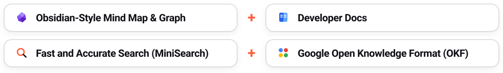
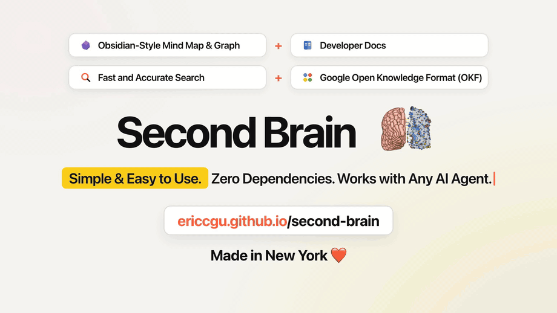
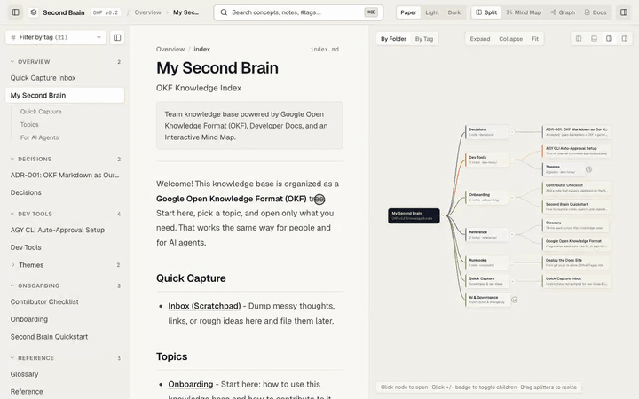
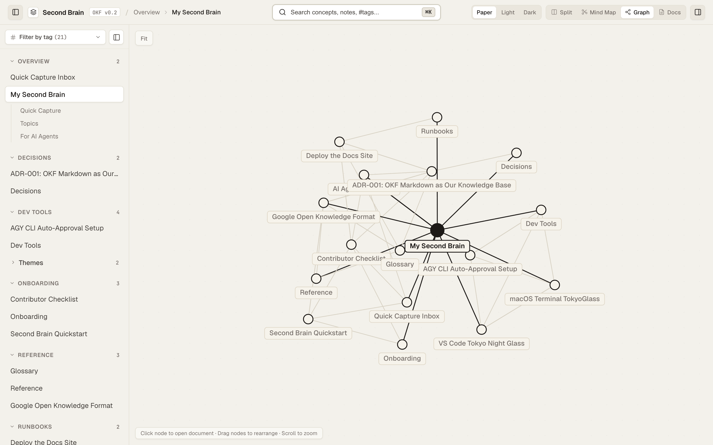
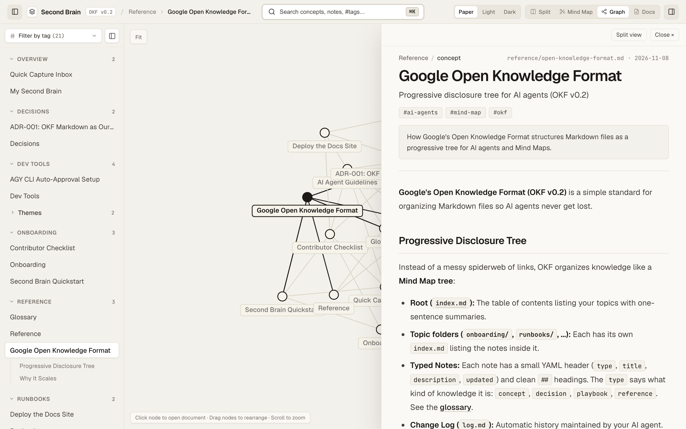
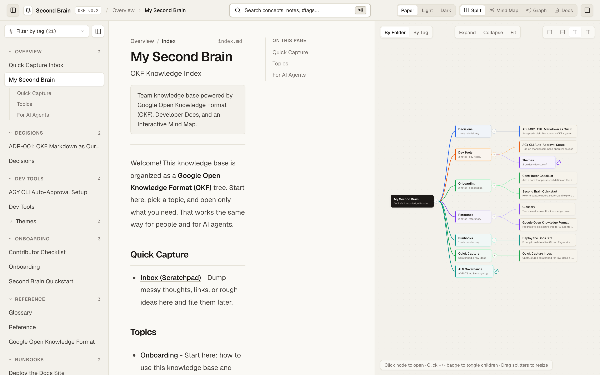
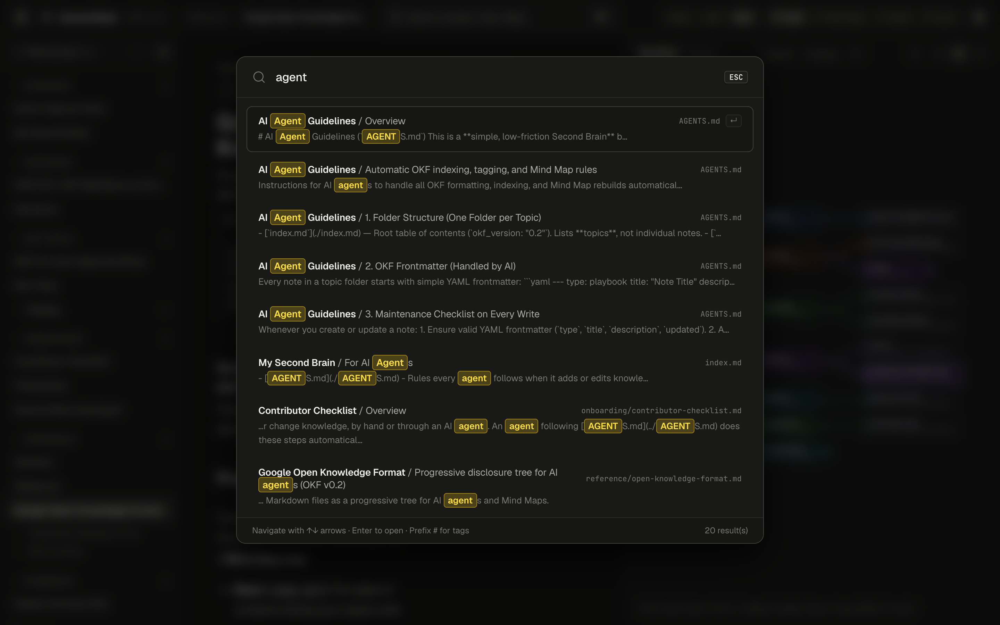

<div align="center">



# Second Brain
### Obsidian-Style Mind Map & Graph + Developer Docs + Fast and Accurate Search + Google Open Knowledge Format (OKF)

**New AI concepts and ideas moving too fast? Second Brain gives you a clean, visual home in plain Markdown. See how your ideas connect on an interactive Mind Map and Graph, read notes right in place, and let your AI assistant handle the filing.**

**Simple & Easy to Use. Zero Dependencies. Works with Any AI Agent.**

[**Live Interactive Demo**](https://ericcgu.github.io/second-brain/) &nbsp;·&nbsp; [**Watch Full Launch Video (MP4)**](./videos/second-brain-launch.mp4) &nbsp;·&nbsp; [**How It Works**](#how-it-works) &nbsp;·&nbsp; [**30-Second Quickstart**](#30-second-quickstart) &nbsp;·&nbsp; [**Mind Map**](https://ericcgu.github.io/second-brain/mindmap/) &nbsp;·&nbsp; [**Knowledge Graph**](https://ericcgu.github.io/second-brain/graph/)

[](https://github.com/ericcgu/second-brain/actions/workflows/deploy.yml)
[](./reference/open-knowledge-format.md)
[](https://ericcgu.github.io/second-brain/?view=docs)
[](./ARCHITECTURE.md)
[](./videos/second-brain-launch.mp4)
[](https://ericcgu.github.io/second-brain/)

<br>

<a href="https://ericcgu.github.io/second-brain/"></a>
<br>
<sub><b><a href="./videos/second-brain-launch.mp4">▶ Watch the HD Launch Video (MP4)</a></b> &nbsp;·&nbsp; <a href="./videos/second-brain-launch.gif">Full Launch GIF</a> &nbsp;·&nbsp; <a href="https://ericcgu.github.io/second-brain/">Open Live Site</a></sub>

</div>

---

## How It Works

There is no database to set up and nothing to install:

1. **Browse visually:** Open the site, click a branch on the **Mind Map**, or explore how ideas link together on the **Knowledge Graph**.
2. **Jot rough notes:** Drop quick thoughts into [`inbox.md`](./inbox.md), or tell your AI assistant *"save a note about X"*.
3. **Publish anywhere:** Push to GitHub. One standard-library Node script checks your links and builds the static site.

---

## Why Human Developers and AI Agents Love It

New AI tools, papers, and project notes come out every day. When everything is buried in chat logs or flat folders of Markdown, it is hard to see how things fit together or find that one note you wrote last week.

**Second Brain** brings four things together in one plain-Markdown repo:

| Core Pillar | For Human Developers | For AI Agents |
|---|---|---|
| **1. Obsidian-Style Mind Map & Graph** | Topics start folded so you never face a wall of text. Click `+` to open a branch, or drag nodes on the graph to see how ideas connect. | Every relative link between Markdown files shows up on the graph and creates backlinks automatically. |
| **2. Clean Developer Docs** | Click any card or graph node to read the note in a side drawer without losing your spot on the map. | [`AGENTS.md`](./AGENTS.md) tells your AI how to format notes, update indexes, and rebuild the site for you. |
| **3. Fast and Accurate Search** | Powered by client-side **MiniSearch**. Search across titles, headings, body text, and `#tags` as you type. | Makes it easy to spot-check any note or concept your AI just added. |
| **4. Google Open Knowledge Format (OKF)** | Plain `.md` files with simple YAML headers that work in any editor and never lock you in. | A clean root [`index.md`](./index.md) and topic indexes let any AI find the right note in 3 quick reads. |

---

## 30-Second Quickstart

Requires **Node.js 18+** (uses only Node's built-in standard library, so no `npm install` is needed):

```bash
# 1. Clone the repository (or click "Use this template" on GitHub)
git clone https://github.com/ericcgu/second-brain.git
cd second-brain

# 2. Check links and build the static site
node scripts/validate-okf.mjs
node scripts/export-graph.mjs

# 3. Open the site locally in your browser
open site/index.html
```

### Let Your AI File the Notes

Because [`AGENTS.md`](./AGENTS.md) sits at the root of the repo, you don't have to format frontmatter or update index files by hand. Works with Claude Code, Cursor, GitHub Copilot, ChatGPT/Codex, Gemini, or any other tool. Just ask:

```text
"Turn my rough notes in inbox.md into a clean concept note and rebuild the site."
"Add a note explaining our authentication flow and link it to our architecture decisions."
"Summarize the notes in reference/ and dev-tools/."
```

---

## Visual Tour

Open the [**Live Demo**](https://ericcgu.github.io/second-brain/) to try it in your browser.

### 1. Interactive Mind Map: Find, Relate, and Connect Ideas

<a href="https://ericcgu.github.io/second-brain/mindmap/"></a>

Simple and easy to use in plain Markdown. Zoom into any topic and read notes right in place:

- **Zoom into any topic:** Topics start compact so you never face a wall of text. Click the `+` badge on any branch to unfold its notes as you explore.
- **Read notes right in place:** Click any card to open the note in a side drawer without losing your position or zoom level on the map.
- **Group by folder or `#tag`:** Switch between `By Folder` and `By Tag` to reorganize your entire knowledge base in one click.

---

### 2. Knowledge Graph & Fast Search

<table>
  <tr>
    <td width="50%">
      <a href="https://ericcgu.github.io/second-brain/graph/"></a><br>
      <sub><b>Interactive Knowledge Graph:</b> Every link between notes becomes a live connection. Drag nodes around, click a concept to highlight everything linked to it, and read it right in place. <a href="https://ericcgu.github.io/second-brain/graph/">Open the Graph →</a></sub>
    </td>
    <td width="50%">
      <a href="https://ericcgu.github.io/second-brain/?view=docs"></a><br>
      <sub><b>Fast Accurate Search:</b> Press <code>/</code> or click Search to filter across titles, headings, and <code>#tags</code> in milliseconds, then copy code blocks in one click. <a href="https://ericcgu.github.io/second-brain/?view=docs">Try Search →</a></sub>
    </td>
  </tr>
</table>

<table>
  <tr>
    <td width="50%">
      <a href="https://ericcgu.github.io/second-brain/graph/"></a><br>
      <sub><b>Full-Screen Graph View:</b> See your entire knowledge base as a constellation of connected ideas.</sub>
    </td>
    <td width="50%">
      <a href="https://ericcgu.github.io/second-brain/graph/"></a><br>
      <sub><b>Highlight & Read in Place:</b> Clicking any node highlights its direct links on the graph and opens the note on the right.</sub>
    </td>
  </tr>
</table>

---

### 3. Paper, Light & Dark Themes

<table>
  <tr>
    <td width="50%"><br><sub><b>Split View (Paper Theme):</b> Read your docs right next to a resizable Mind Map or Graph pane.</sub></td>
    <td width="50%"><br><sub><b>Dark Mode & Search:</b> Switch between Warm Paper, Crisp Light, and Dark Mode anytime.</sub></td>
  </tr>
</table>

---

## Folder Structure

Everything is plain Markdown organized with **[Google's Open Knowledge Format (OKF v0.2)](./reference/open-knowledge-format.md)**:

```text
second-brain/
├── index.md              # Root table of contents listing your top-level topics
├── inbox.md              # Quick scratchpad for rough ideas during the day
├── AGENTS.md             # Instructions so AI assistants can file & check notes for you
├── log.md                # Simple chronological changelog
├── onboarding/           # Getting started guides & contributor checklist
├── reference/            # Core concepts, specs & glossary
├── decisions/            # Architecture & product decisions (ADRs)
├── runbooks/             # Step-by-step guides & workflows
├── dev-tools/            # Local editor, terminal & theme setups
├── videos/
│   ├── second-brain-launch.mp4  # HD launch video walkthrough
│   └── second-brain-launch.gif  # Fast animated preview GIF
├── scripts/
│   ├── validate-okf.mjs  # Checks frontmatter & makes sure no links are broken
│   └── export-graph.mjs  # Compiles Markdown into site/index.html
└── site/                 # Generated static site (works offline or on GitHub Pages)
```

---

## Publish Your Own in 2 Minutes

1. Click **Use this template** (or fork) on GitHub and clone your repo.
2. In your GitHub repo, go to **Settings → Pages** and set **Source** to **GitHub Actions**.
3. Push any change to `main`. The included GitHub Action ([`.github/workflows/deploy.yml`](./.github/workflows/deploy.yml)) checks your links, builds the site, and publishes it to GitHub Pages.

---

## Where to Start

- **New here?** Read the [**Second Brain Quickstart**](./onboarding/second-brain-quickstart.md) and [**Contributor Checklist**](./onboarding/contributor-checklist.md).
- **Curious how the format works?** Check out [**Google Open Knowledge Format (OKF v0.2)**](./reference/open-knowledge-format.md) and the [**Glossary**](./reference/glossary.md).
- **Want to see how the build script works?** See [`AGENTS.md`](./AGENTS.md) and [`ARCHITECTURE.md`](./ARCHITECTURE.md).

---

<div align="center">
  <h2>Made in New York ❤️</h2>
</div>
